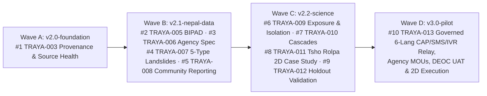

# Roadmap — Nepal TRĀYA 2.0 (Waves A–D)

This roadmap charts the evolution of **Nepal TRĀYA (त्राय)** from its hardened 7-day open-data screening baseline into **TRĀYA 2.0** (full provenance, official Nepal statutory data separation, 5-type landslide cataloguing, offline-first community landslide reporting governance, road-cut hospital isolation, interpretable multi-hazard cascades, all-weather Sentinel-1 SAR EO, event-calibrated landslide validation, and 6-language OASIS CAP v1.2 Exercise drafts) and forward toward **Wave D (`v3.0-pilot`)** institutional co-design, agency MOU activation, and 2D hydrodynamic GLOF execution.

All implementation milestones obey TRĀYA's **non-negotiable engineering & safety invariants**:
- **Non-Operational Safety Boundary:** TRĀYA never impersonates an operational early warning system; official Nepal agencies (**DHM `1155`**, **NDRRMA/NEOC `1149`**, **DMG/NEMRC**, **DoR**) remain the sole statutory warning authorities.
- **Pure Python 3.12 Stdlib Weekly Pipeline:** Zero external `pip` dependencies in `src/integrations/*.py`, `src/landslides.py`, `src/moderation.py`, `src/cap_relay.py`, `src/exposure_isolation.py`, `src/cascades.py`, `src/tsho_rolpa_pilot.py`, `src/refresh_weekly.py`, `src/verify_site.py`, and `--unit-only` tests.
- **Hardened Static Frontend:** Strict Content-Security-Policy (zero inline `<script>`, zero inline `<style>`, zero `on*=` attributes, zero external JS/font CDNs), `<meta name="referrer" content="strict-origin-when-cross-origin">`, byte-identical `index.html === src/template.html`, Node 24-native GitHub Actions workflows (`0` Node 20 actions), and `.prazg-suite-bar` suite integration.

---

## Delivery Architecture Across Waves A–D

---

## Complete Issue & Milestone Mapping (`#1`–`#10`)

| GitHub Issue | Spec ID | Wave | Milestone | GitHub Issue Title & Primary Deliverables | Status |
| --- | --- | --- | --- | --- | --- |
| [#1](https://github.com/prazg/Nepal_TRAYA/issues/1) | `TRAYA-003` | **Wave A** | [`v2.0-foundation`](https://github.com/prazg/Nepal_TRAYA/milestones) | **6-State `ProvenanceEnvelope`, SHA-256 Build Manifest & Source Health Contract** (`src/integrations/provenance.py`, `src/integrations/{usgs,openmeteo,osm,icimod,copernicus}.py`, `data/manifest.json`, `data/kpi_baseline.json`) | Implemented (TRĀYA 2.0) |
| [#2](https://github.com/prazg/Nepal_TRAYA/issues/2) | `TRAYA-005` | **Wave B** | [`v2.1-nepal-data`](https://github.com/prazg/Nepal_TRAYA/milestones) | **Official NDRRMA BIPAD Portal API v1 Client & Official-vs-Modelled Separation** (`src/integrations/bipad.py`, `cache/bipad_snapshot.json`, `data/bipad_official.json`) | Implemented (TRĀYA 2.0) |
| [#3](https://github.com/prazg/Nepal_TRAYA/issues/3) | `TRAYA-006` | **Wave B** | [`v2.1-nepal-data`](https://github.com/prazg/Nepal_TRAYA/milestones) | **Institutional Integration Specification & Agency Adapter Stubs — DHM, DMG/NEMRC, NDRRMA/BIPAD & DoR** ([`docs/INSTITUTIONAL_INTEGRATION_SPEC.md`](docs/INSTITUTIONAL_INTEGRATION_SPEC.md), `src/integrations/{dhm,nemrc,roads_authority}.py`, [`DATA_LICENSES.md`](DATA_LICENSES.md), [`docs/MODEL_CARDS.md`](docs/MODEL_CARDS.md)) | Implemented (TRĀYA 2.0) |
| [#4](https://github.com/prazg/Nepal_TRAYA/issues/4) | `TRAYA-007` | **Wave B** | [`v2.1-nepal-data`](https://github.com/prazg/Nepal_TRAYA/milestones) | **5-Type National Landslide Inventory, `landslide_event.v1` Schema & Flag-Only Duplicate Review Queue** (`src/landslides.py`, `schemas/landslide_event.v1.schema.json`, `data/landslides.json`, `data/landslide_review_queue.json`, `data/landslide_inventory.geojson`) | Implemented (TRĀYA 2.0) |
| [#5](https://github.com/prazg/Nepal_TRAYA/issues/5) | `TRAYA-008` | **Wave B** | [`v2.1-nepal-data`](https://github.com/prazg/Nepal_TRAYA/milestones) | **Offline-first PWA community landslide reporting** (`schemas/community_report.v1.schema.json`, `src/moderation.py`, `data/moderation_queue.json`, [`docs/COMMUNITY_REPORTING_GOVERNANCE.md`](docs/COMMUNITY_REPORTING_GOVERNANCE.md)) | Implemented (Pre-MOU Sandbox / UAT Ready) |
| [#6](https://github.com/prazg/Nepal_TRAYA/issues/6) | `TRAYA-009` | **Wave C** | [`v2.2-science`](https://github.com/prazg/Nepal_TRAYA/milestones) | **1 km Corridor Exposure Breakdown & Road-Cut Hospital Isolation Screening** (`src/exposure_isolation.py`, `data/exposure_isolation.json`) | Implemented (TRĀYA 2.0) |
| [#7](https://github.com/prazg/Nepal_TRAYA/issues/7) | `TRAYA-010` | **Wave C** | [`v2.2-science`](https://github.com/prazg/Nepal_TRAYA/milestones) | **Interpretable Directed Multi-Hazard Cascade Graph Engine** (`src/cascades.py`, `data/cascades.json`) | Implemented (TRĀYA 2.0) |
| [#8](https://github.com/prazg/Nepal_TRAYA/issues/8) | `TRAYA-011` | **Wave C** | [`v2.2-science`](https://github.com/prazg/Nepal_TRAYA/milestones) | **Tsho Rolpa 2D hydrodynamic case study** ([`docs/TSHO_ROLPA_2D_STUDY_PLAN.md`](docs/TSHO_ROLPA_2D_STUDY_PLAN.md), `src/tsho_rolpa_pilot.py`, `data/tsho_rolpa_pilot.json`) | Study Plan & Pre-Sim Benchmark Implemented (2D Execution Wave D) |
| [#9](https://github.com/prazg/Nepal_TRAYA/issues/9) | `TRAYA-012` | **Wave C** | [`v2.2-science`](https://github.com/prazg/Nepal_TRAYA/milestones) | **Event-calibrated landslide holdout validation** (paired with all-weather Sentinel-1 SAR / Sentinel-2 EO discovery in `src/integrations/copernicus.py`, `data/eo_sar.json`, and `src/validate.py` validation suite) | Baseline Validation & SAR EO Implemented (Event-Calibrated Holdout Active) |
| [#10](https://github.com/prazg/Nepal_TRAYA/issues/10) | `TRAYA-013` | **Wave D** | [`v3.0-pilot`](https://github.com/prazg/Nepal_TRAYA/milestones) | **Governed multilingual EN/NE/Maithili/Bhojpuri/Tharu/Tamang CAP/SMS/IVR relay** (`schemas/cap_v12_advisory.schema.json`, `src/cap_relay.py`, `data/cap_drafts.json`, `data/cap_exercise_latest.xml`, [`docs/wave_d/AGENCY_MOU_TEMPLATE.md`](docs/wave_d/AGENCY_MOU_TEMPLATE.md), [`docs/wave_d/MULTILINGUAL_CAP_SMS_IVR_SOP.md`](docs/wave_d/MULTILINGUAL_CAP_SMS_IVR_SOP.md), [`docs/wave_d/DEOC_UAT_PROTOCOL.md`](docs/wave_d/DEOC_UAT_PROTOCOL.md)) | Exercise/Draft Framework Implemented (Live Relay Post-MOU Only) |

---

## Wave-by-Wave Scope & Milestone Exit Criteria

### Wave A — Foundation, Provenance & Source Health (`v2.0-foundation`)
Builds atop the hardened v2 baseline (pure-stdlib 7-day refresh, Node 24 workflows, strict CSP, bilingual `EN/NE` UI, 77-district/7-province triage) to guarantee end-to-end data-lineage auditability:
- **[#1](https://github.com/prazg/Nepal_TRAYA/issues/1) (`TRAYA-003`):** Introduces canonical `ProvenanceEnvelope` (`schema_version = "2.0.0"`, `src/integrations/provenance.py`) classifying every feed into 6 `data_class` states (`live_observation`, `forecast`, `historical`, `static_assessment`, `cached`, `unavailable`), 3 freshness statuses (`available`, `stale`, `unavailable`), and 3 platform health roll-ups (`healthy`, `degraded`, `stale`). Generates deterministic SHA-256 build manifests (`data/manifest.json`), KPI baselines (`data/kpi_baseline.json`), and wraps open-data feeds (`usgs.py`, `openmeteo.py`, `osm.py`, `icimod.py`, `copernicus.py`).
- **Exit Criteria:** Every core dataset emits a validated `ProvenanceEnvelope`; `data/manifest.json` passes checksum & freshness checks in `src/verify_site.py`; Source Health UI surfaces exact staleness and fallback status transparently.

### Wave B — Official Nepal Data Separation, 5-Type Landslides & Community Reporting Governance (`v2.1-nepal-data`)
Bridges global open models with sovereign Government of Nepal statutory data while enforcing strict privacy, licensing, epistemic, and UI boundaries:
- **[#2](https://github.com/prazg/Nepal_TRAYA/issues/2) (`TRAYA-005`):** Live read-only ingestion from verified public BIPAD Portal v1 endpoints (`/alert/`, `/incident/?hazard=17&expand=loss`, `/river/`, `/rain/`, `/earthquake/`) into `data/bipad_official.json` with strict `null`-preservation and dedicated Official Statutory UI separation.
- **[#3](https://github.com/prazg/Nepal_TRAYA/issues/3) (`TRAYA-006`):** Formal technical specification ([`docs/INSTITUTIONAL_INTEGRATION_SPEC.md`](docs/INSTITUTIONAL_INTEGRATION_SPEC.md)), code-vs-data license separation ([`DATA_LICENSES.md`](DATA_LICENSES.md)), 6 scientific model cards ([`docs/MODEL_CARDS.md`](docs/MODEL_CARDS.md)), and standardized `requires_institutional_agreement: true` adapter stubs (`dhm.py`, `nemrc.py`, `roads_authority.py`).
- **[#4](https://github.com/prazg/Nepal_TRAYA/issues/4) (`TRAYA-007`):** Formal JSON Schema ([`schemas/landslide_event.v1.schema.json`](schemas/landslide_event.v1.schema.json)) partitioning records into 5 canonical `feature_type` classes (`landslide_event`, `landslide_scar`, `susceptibility_zone`, `hazard_report`, `coseismic_failure`), strict `null`-not-`0` casualty/date enforcement, flag-only duplicate detection (`<= 1.5 km` & `<= 3 days` dated; `<= 0.35 km` undated cross-source → `data/landslide_review_queue.json`, `auto_merged: false`), and QGIS-ready RFC 7946 `data/landslide_inventory.geojson`.
- **[#5](https://github.com/prazg/Nepal_TRAYA/issues/5) (`TRAYA-008`) — Offline-first PWA community landslide reporting:** Formal JSON Schema ([`schemas/community_report.v1.schema.json`](schemas/community_report.v1.schema.json)), pure-stdlib deterministic PII redactor (`redact_pii`), SHA-256 deduplication fingerprinting, strict EXIF-stripping & unverified `null`-not-`0` casualty validation, flag-only inventory duplicate screening, and authenticated agency-officer moderation state machine (`deoc_officer`, `ndrrma_verifier`, `dhm_verifier`) in `src/moderation.py` → `data/moderation_queue.json` (`governance_mode: "pilot_sandbox_post_mou"`, `public_live_endpoint_enabled: false`) documented in [`docs/COMMUNITY_REPORTING_GOVERNANCE.md`](docs/COMMUNITY_REPORTING_GOVERNANCE.md).
- **Exit Criteria:** Zero silent merging of official statutory alerts with modelled watches; zero `None -> 0` casualty coercion; zero unredacted PII or unstripped EXIF acceptance; all governance/schema checks passing CI gates.

### Wave C — Next-Generation Multi-Hazard Science, Tsho Rolpa 2D Case Study & Event-Calibrated Validation (`v2.2-science`)
Upgrades TRĀYA from isolated single-hazard layers to connected corridor-impact, cascade-pathway, 2D hydrodynamic benchmarking, and empirical validation:
- **[#6](https://github.com/prazg/Nepal_TRAYA/issues/6) (`TRAYA-009`):** `src/exposure_isolation.py` emits `data/exposure_isolation.json` separating static GLOF susceptibility, cleaned 1 km corridor exposure (human health, vehicular vs. trail bridges, deduplicated hydropower MW), and 3 explicit road-cut hospital isolation mechanisms (`downstream_bridge_cut`, `cross_river_bridge_cut`, `upper_valley_single_egress_cut`) rolled up across 77 districts.
- **[#7](https://github.com/prazg/Nepal_TRAYA/issues/7) (`TRAYA-010`):** `src/cascades.py` evaluates 3 inspectable physical cascade chains (`rain_landslide_dam_road`, `quake_coseismic_isolation`, `glof_infra_isolation`) with per-edge `evidence_type`, explicit `trigger_rule`, `uncertainty_note`, strict isolation of undated OSM scars, and bilingual `EN/NE` summaries (`data/cascades.json`).
- **[#8](https://github.com/prazg/Nepal_TRAYA/issues/8) (`TRAYA-011`) — Tsho Rolpa 2D hydrodynamic case study:** Reproducible 2D hydrodynamic GLOF study protocol ([`docs/TSHO_ROLPA_2D_STUDY_PLAN.md`](docs/TSHO_ROLPA_2D_STUDY_PLAN.md)) and pre-simulation benchmark builder (`src/tsho_rolpa_pilot.py` → `data/tsho_rolpa_pilot.json`) detailing bathymetry, 1998–2000 lowering history, 4×3 breach/bulking hydrograph ensemble, `LISFLOOD-FP v8.1` (`fv1`) + `BASEMENT v4` configurations, 10 Rolwaling–Tama Koshi / Upper Tamakoshi HPP checkpoints, and 6 quantitative validation gates.
- **[#9](https://github.com/prazg/Nepal_TRAYA/issues/9) (`TRAYA-012`) — Event-calibrated landslide holdout validation:** Spatiotemporal holdout calibration framework evaluating Dahal–Hasegawa (2008) & Guzzetti (2008) rainfall thresholds against dated verified BIPAD/COOLR landslide events (strictly excluding undated OSM scars), paired with all-weather Copernicus **Sentinel-1 GRD** SAR & **Sentinel-2 L2A** optical discovery (`src/integrations/copernicus.py` → `data/eo_sar.json`) for monsoon slope/lake observation.
- **Exit Criteria:** Pure-stdlib unit tests verify isolation mechanisms, cascade epistemic guardrails, SAR STAC parsing, and Tsho Rolpa pre-simulation framing; `python src/verify_site.py` passes with zero regressions.

### Wave D — Governed 6-Language CAP/SMS/IVR Relay, Agency MOUs & DEOC UAT Pilot (`v3.0-pilot`)
Transitions selected research pilots into institutionally reviewed, field-calibrated decision-support tools — gated strictly behind formal Government of Nepal partnerships:
- **[#10](https://github.com/prazg/Nepal_TRAYA/issues/10) (`TRAYA-013`) — Governed multilingual EN/NE/Maithili/Bhojpuri/Tharu/Tamang CAP/SMS/IVR relay:**
  1. **OASIS CAP v1.2 Exercise Framework (Implemented — Sandbox Only):** Formal JSON Schema ([`schemas/cap_v12_advisory.schema.json`](schemas/cap_v12_advisory.schema.json)) and pure-stdlib generator (`src/cap_relay.py`) producing standards-compliant `urn:oasis:names:tc:emergency:cap:1.2` Exercise advisories (`data/cap_drafts.json`, `data/cap_exercise_latest.xml`) across all **6 Nepal languages** (`en`, `ne`, `mai`, `bho`, `thr`, `taj`), complete with GSM-7/UCS-2 SMS drafts (`<= 160` ASCII / `<= 140` Devanagari), 25–35 s spoken IVR scripts, official hotlines (`1155 / 1149 / 1114 / 100 / 102`), explicit `linguistic_review_status`, and hard-locked `relay_governance.relay_enabled = false`.
  2. **Wave D Institutional Activation Pack (Implemented — Ready for Agency Review):** Draft multi-agency MOU template ([`docs/wave_d/AGENCY_MOU_TEMPLATE.md`](docs/wave_d/AGENCY_MOU_TEMPLATE.md)), NTC/Ncell SMS & IVR + 6-language native validation SOP ([`docs/wave_d/MULTILINGUAL_CAP_SMS_IVR_SOP.md`](docs/wave_d/MULTILINGUAL_CAP_SMS_IVR_SOP.md)), and structured 4-cohort DEOC UAT protocol covering **Dolakha, Ramechhap, Madhesh, and Kailali/Bardiya** ([`docs/wave_d/DEOC_UAT_PROTOCOL.md`](docs/wave_d/DEOC_UAT_PROTOCOL.md)).
  3. **Post-MOU Wave D Execution:** Activate authorized direct DHM 15-minute telemetry, DMG/NEMRC local $M_L$ seismic bulletins, DoR highway blockage feeds, DEOC-moderated community reporting pilot, GPU/HPC execution of Phases 2–4 of the **Tsho Rolpa 2D Hydrodynamic Study Plan** (`TRAYA-011`), and native-approved CAP v1.2 pilot drills.
- **Hard Safety Gate:** Zero automated public alerting, zero `<status>Actual</status>` CAP broadcasts, and zero live public reporting endpoints without signed statutory agency MOUs, completed DEOC UAT exit gates, and legal mandate confirmation under Nepal's *Disaster Risk Reduction and Management Act, 2074 (2017)* and *Individual Privacy Act, 2075 (2018)*.

---

## Contributing & Governance

- Report bugs, scientific discrepancies, or institutional collaboration proposals via [GitHub Issues](https://github.com/prazg/Nepal_TRAYA/issues).
- Report security, privacy, or CSP issues privately per [`SECURITY.md`](SECURITY.md).
- Review licensing and upstream attribution rules before reusing derived payloads in [`DATA_LICENSES.md`](DATA_LICENSES.md).
