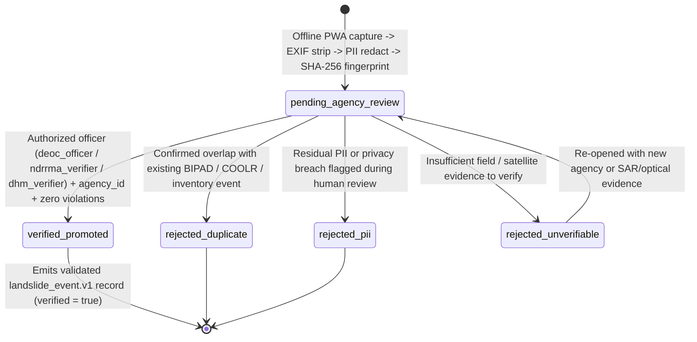

# Community Landslide Reporting & Moderation Governance — Nepal TRĀYA 2.0 (`TRAYA-008` / Issue `#5`)

**Document ID:** `TRAYA-008` | **Milestone:** `v2.1-nepal-data` (Sandbox & Schema) → `v3.0-pilot` (Post-MOU DEOC Pilot)  
**Primary Artifacts:** [`schemas/community_report.v1.schema.json`](../schemas/community_report.v1.schema.json), [`src/moderation.py`](../src/moderation.py), [`data/moderation_queue.json`](../data/moderation_queue.json), [`schemas/landslide_event.v1.schema.json`](../schemas/landslide_event.v1.schema.json)

> **Non-Operational Public-Safety Notice (गैर-सञ्चालनात्मक सूचना):**  
> **Community landslide reporting in TRĀYA is NOT an emergency rescue or 24/7 dispatch service.** Anyone witnessing an active life-threatening landslide, flash flood, or trapped persons in Nepal MUST immediately call **Nepal Police (`100`)**, **Ambulance (`102`)**, **Armed Police Force Search & Rescue (`1114`)**, **NDRRMA/NEOC (`1149`)**, or **DHM Flood Helpline (`1155`)**.  
> **Pre-MOU Sandbox Gate:** `public_live_endpoint_enabled` is strictly `false` (`governance_mode: "pilot_sandbox_post_mou"`). No unmoderated public submissions are accepted or published onto TRĀYA's static observatory prior to executed Wave D agency MOUs ([`docs/wave_d/AGENCY_MOU_TEMPLATE.md`](wave_d/AGENCY_MOU_TEMPLATE.md)).

---

## 1. Purpose & Epistemic Separation

Rural Himalayan valleys frequently experience monsoon slope failures hours or days before formal national incident records appear in public portals. However, raw crowd-sourced observations carry three major public-safety and scientific risks:
1. **Unverified Misinformation & Duplicate Inflation:** Rumors, mislocated pins, or repeat reports of the same highway cut can distort district triage counts if blended directly with statutory NDRRMA BIPAD records.
2. **Citizen Privacy & Personal Data Exposure:** Field narratives often inadvertently contain mobile phone numbers, email addresses, citizenship/license numbers, social handles, or GPS/camera EXIF metadata that violate Nepal's *Individual Privacy Act, 2075 (2018)*.
3. **False Zero-Casualty Bias:** Treating omitted casualty fields on an unverified citizen report as `0` deaths corrupts downstream vulnerability and mortality statistics.

TRĀYA 2.0 solves all three through a **strictly partitioned, privacy-first, agency-moderated pipeline**:
- Every incoming citizen/field submission is typed strictly as `feature_type: "hazard_report"` under [`schemas/community_report.v1.schema.json`](../schemas/community_report.v1.schema.json).
- Unverified reports NEVER enter `data/landslides.json` as confirmed `landslide_event` records and NEVER trigger live multi-hazard cascade edges.
- Promotion into a `schemas/landslide_event.v1.schema.json` compatible record requires explicit authenticated action by an authorized statutory verifier (`deoc_officer`, `ndrrma_verifier`, or `dhm_verifier`) carrying a non-empty `agency_id`.

---

## 2. Offline-First PWA & IndexedDB Capture Architecture

Mountain monsoon storms routinely knock out Ncell/NTC cellular towers and fibre backhaul across districts such as Dolakha, Sindhupalchok, Rasuwa, Gorkha, and Kalikot. The Wave D pilot reporting client is architected as an **offline-first Progressive Web App (PWA)** obeying TRĀYA's strict Content-Security-Policy (zero inline `<script>`, zero inline `<style>`, zero `on*=` attributes, zero third-party CDNs):

| Stage | Offline Client Behavior (Browser / Mobile PWA) | Privacy & Integrity Guarantee |
| --- | --- | --- |
| **1. Shell & Reference Caching** | Service Worker caches static HTML/CSS/ES modules and compact 77-district centroid lookup offline (`CacheStorage`, same-origin `'self'` only). | Works with zero cellular signal after first load; `<meta name="referrer" content="strict-origin-when-cross-origin">`. |
| **2. Location Capture** | Captures WGS84 `lon`/`lat` via `navigator.geolocation` (`location_source: "gps"`, recording `location_accuracy_m`) or offline map crosshair (`location_source: "manual_pin"`). | Enforces Nepal regional bounds (`79.5 <= lon <= 88.8`, `26.0 <= lat <= 31.0`) client-side and server-side. |
| **3. On-Device Photo EXIF Stripping** | Optional field photo is decoded into an offscreen HTML5 `<canvas>` and re-encoded to a bounded JPEG/WebP blob (`<= 1.5 MB`, max `1600 px` long edge), discarding **all** EXIF, XMP, IPTC, camera serial, and embedded GPS tags before persistence. | Sets `exif_stripped: true` and computes `photo_sha256`. Backend rejects any payload where `exif_stripped !== true`. |
| **4. Client-Side + Server-Side PII Scrubbing** | Runs deterministic redaction preview in browser AND re-runs authoritative `src/moderation.py::redact_pii()` before queueing. | Zero reporter name, phone, email, device IMEI, or raw IP address stored in the moderation queue. |
| **5. IndexedDB Outbox Staging** | Stores validated `community_report.v1` drafts in IndexedDB (`traya_offline_outbox` object store) keyed by `report_id` and deterministic SHA-256 `dedup_fingerprint`. | Survives device reboot and multi-day blackouts; prevents duplicate retransmissions on flaky 2G/3G links. |
| **6. Deferred Sync (Post-MOU Only)** | When connectivity returns and the authenticated pilot endpoint is enabled post-MOU, Background Sync / manual "Sync Outbox" uploads signed JSON over HTTPS TLS 1.3 with exponential backoff. | Pre-MOU sandbox keeps `public_live_endpoint_enabled: false` and operates strictly with synthetic UAT fixtures (`is_uat_fixture: true`). |

---

## 3. Deterministic PII Redaction & EXIF Stripping Policy

Implemented in [`src/moderation.py`](../src/moderation.py) (pure Python 3.12 stdlib, zero external dependencies):

| PII Category | Detection Scope (`redact_pii`) | Replacement Token | Redaction Tag |
| --- | --- | --- | --- |
| **Email Addresses** | RFC-style email addresses (`user@domain.tld`) | `[REDACTED_EMAIL]` | `email` |
| **Nepal Phone Numbers** | `+977` / `00977` international mobile & landline, 10-digit Nepal mobile (`98xxxxxxxx`, `97xxxxxxxx`, `96xxxxxxxx`), Kathmandu landline (`01-xxxxxxx`), regional STD landlines (`011-`, `02x-`..`09x-`), and Devanagari digits (`९८...`, `०१-...`). Preserves Nepal emergency hotlines (`100`, `102`, `1114`, `1149`, `1155`), decimal coordinates, and elevations. | `[REDACTED_PHONE]` | `phone` |
| **Citizenship, License & National IDs** | Formatted Nepal citizenship numbers (`XX-XX-XX-XXXXX`), driving license numbers (`XX-XX-XXXXXXXX`), National ID (`XXX-XXX-XXX-X`), labeled citizenship/NID/license/passport strings (English & Devanagari `नागरिकता`), and standalone 10–16 digit numeric IDs. | `[REDACTED_ID]` | `id` |
| **Social Media Handles** | `@username` handles (evaluated strictly after email redaction so domains are not misclassified). | `[REDACTED_HANDLE]` | `handle` |

### Hard Validation Invariants (`validate_community_report`)
Every submission is rejected prior to moderation promotion if ANY of the following fail:
1. **`exif_stripped` is not strictly `True`** (even when `photo_attached` is `False`, the invariant confirms no raw EXIF-bearing media entered the record).
2. **`pii_redaction_applied` is not strictly `True`** or idempotent re-scanning via `redact_pii(description_redacted)` detects any residual unredacted PII.
3. **`feature_type != "hazard_report"`** or invalid `moderation_status`.
4. **Strict `null`-not-`0` casualty violation:** `fatalities == 0` or `injuries == 0` on any unverified report (`moderation_status != "verified_promoted"`). Unknown counts MUST be `null`.
5. **Temporal consistency violation:** `event_date_utc is None` requires `time_precision == "unknown"`; dated reports require `time_precision` in `exact_hour | day | month | year`.
6. **Fingerprint integrity:** `dedup_fingerprint` must be a valid 64-character lowercase SHA-256 hex digest computed by `compute_dedup_fingerprint(lon, lat, event_date_utc, trigger)`.

---

## 4. Authenticated Agency Moderation State Machine



### Role-Based Authorization (`transition_moderation_state`)
- **Authorized Roles:** Strictly restricted to `deoc_officer` (District Emergency Operation Centre officer), `ndrrma_verifier` (NDRRMA / BIPAD verification officer), and `dhm_verifier` (DHM hydro-geological verifier). Public/anonymous or unauthenticated callers raise `PermissionError`.
- **Mandatory `agency_id`:** Every state transition — and promotion in particular — is strictly refused unless a non-empty institutional `agency_id` (e.g., `DEOC-DOLAKHA-01`, `NDRRMA-NEOC-04`) is supplied and logged to the append-only `moderation_history` audit trail.
- **Canonical Promotion:** Transitioning to `verified_promoted` invokes `promote_to_landslide_event_v1()` and validates the resulting record directly against `src/landslides.py::validate_landslide_record()` (`schemas/landslide_event.v1.schema.json`), mapping `time_precision: "exact_hour"` → `date_precision: "day"` and setting `provider_id: "community_field"` and `verified: true`.

---

## 5. Flag-Only Duplicate Detection (Never Auto-Merged)

`check_duplicate_against_inventory(report, inventory_events, max_km=1.5, max_days=3)` screens every queued report against `data/landslides.json` (`BIPAD`, `NASA COOLR`, and `OSM` records) using the exact same spatiotemporal thresholds as `src/landslides.py`:
- **Exact Fingerprint Match:** Identical SHA-256 `dedup_fingerprint`.
- **Dated Spatiotemporal Match:** Both records dated, Haversine distance $\le 1.5\text{ km}$, and temporal separation $\le 3\text{ days}$.
- **Undated Spatial Match:** Either record undated and Haversine distance $\le 0.35\text{ km}$.

Every candidate match is attached with `review_status: "pending_review"` and `auto_merged: false`. Duplicate resolution is strictly a human agency officer decision (`rejected_duplicate` vs. `verified_promoted`), preventing silent data loss when two distinct slope failures occur along the same monsoon highway corridor.

---

## 6. Anti-Abuse, Anti-Spam & Security Controls (Post-MOU Deployment)

Before flipping `public_live_endpoint_enabled` from `false` to `true` in a post-MOU Wave D pilot, the hosting agency relay MUST enforce:
1. **Scoped Pilot Authentication / Ward-Volunteer Tokens:** Initial Wave D pilots restrict submission tokens to trained local ward volunteers, municipal DRR focal points, and Red Cross chapters rather than open anonymous internet writes.
2. **Rate Limiting & Duplicate-Storm Quenching:** Max 5 submissions per device token per hour; burst suppression on repeated `dedup_fingerprint` digests within a 15-minute window.
3. **Payload Size & MIME Hardening:** Strict JSON schema validation (`<= 32 KB` metadata payload), binary magic-byte inspection (`JPEG`/`WebP` only, `<= 1.5 MB`), and server-side re-encode verification confirming zero EXIF segments.
4. **XSS & Output Escaping:** All moderated text fields (`description_redacted`, `title`, `municipality_ward`) are rendered strictly via `textContent` or HTML-escaped helpers (`esc()`) — never `innerHTML` — and external URLs are disallowed inside free-text submissions.
5. **Data Retention & Right of Erasure:** Rejected records (`rejected_pii`) are purged within 72 hours; approved anonymized geohazard observations retain zero personal identifiers in compliance with Nepal's *Individual Privacy Act, 2075 (2018)*.
6. **Emergency Kill-Switch:** Any signatory agency (`NDRRMA`, `DHM`, or pilot DEOC) may immediately set `public_live_endpoint_enabled: false` to halt ingestion during misuse or security incidents.

---

## 7. Sandbox Queue Inspection & Local Verification

Generate and verify the pre-MOU sandbox moderation queue (`data/moderation_queue.json`, containing 2 clean synthetic UAT exercise fixtures in **Dolakha** and **Sindhupalchok** tagged `is_uat_fixture: true`):

```bash
python -B src/moderation.py
```

See [`docs/wave_d/DEOC_UAT_PROTOCOL.md`](wave_d/DEOC_UAT_PROTOCOL.md) for the hands-on DEOC moderation drill rubric and [`docs/wave_d/AGENCY_MOU_TEMPLATE.md`](wave_d/AGENCY_MOU_TEMPLATE.md) for institutional activation prerequisites.
