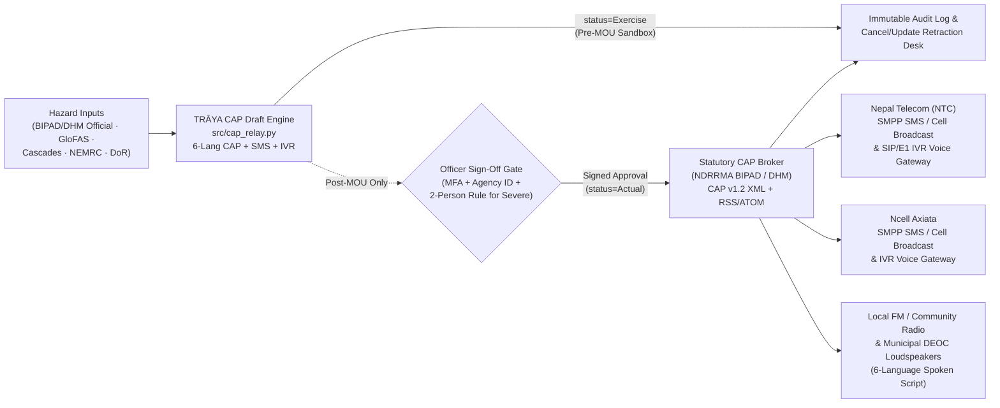

# Standard Operating Procedure: Governed 6-Language OASIS CAP v1.2, SMS & IVR Relay (`TRAYA-013` / Issue `#10`)

**Document ID:** `TRAYA-013-SOP` | **Target Phase:** Wave D (`v3.0-pilot`)  
**Standards:** ITU-T X.1303 / OASIS Common Alerting Protocol v1.2 (`urn:oasis:names:tc:emergency:cap:1.2`), GSM 03.38 (GSM-7 / UCS-2 SMS), RFC 5646 / ISO 639-1 & 639-3 Language Tags  
**Primary Artifacts:** [`schemas/cap_v12_advisory.schema.json`](../../schemas/cap_v12_advisory.schema.json), [`src/cap_relay.py`](../../src/cap_relay.py), [`data/cap_drafts.json`](../../data/cap_drafts.json), [`data/cap_exercise_latest.xml`](../../data/cap_exercise_latest.xml)

> **HARD SAFETY LOCK (PRE-MOU SANDBOX):**  
> In TRĀYA 2.0, `relay_governance.relay_enabled` is strictly `false`, `statutory_warning` is `false`, and every generated OASIS CAP v1.2 XML/JSON payload carries `<status>Exercise</status>` (`scope = Restricted`). **ZERO live public SMS, IVR voice calls, or `<status>Actual</status>` CAP feeds are transmitted** until formal Government of Nepal agency MOUs ([`AGENCY_MOU_TEMPLATE.md`](AGENCY_MOU_TEMPLATE.md)), native municipal linguistic sign-offs, and DEOC UAT gates ([`DEOC_UAT_PROTOCOL.md`](DEOC_UAT_PROTOCOL.md)) are completed in writing.

---

## 1. Operational Scope & Nepal CAP v1.2 Profile

This SOP defines the end-to-end technical, linguistic, and officer-authorization procedure for generating, reviewing, signing off, transmitting, and cancelling multilingual multi-hazard advisories derived from statutory Nepal alerts (DHM, NDRRMA/BIPAD, DMG/NEMRC, DoR) and contextual screening triggers.

### 1.1 Mandatory OASIS CAP v1.2 Profile Elements
Every CAP XML envelope (`data/cap_exercise_latest.xml` and post-MOU broker payloads) MUST conform strictly to OASIS CAP v1.2 XSD (`urn:oasis:names:tc:emergency:cap:1.2`):

| CAP v1.2 Element | Pre-MOU Sandbox Value (`TRĀYA 2.0`) | Post-MOU Pilot Value (Agency-Authorized Only) | Governance Rule |
| --- | --- | --- | --- |
| `<identifier>` | `urn:traya:cap:exercise:<scenario>:<UTC>` | `urn:gov.np:<agency>:cap:<id>` | Globally unique; no whitespace, commas, `<`, or `&`. |
| `<sender>` | `traya-exercise-sandbox@prazg.github.io` | Verified agency sender (e.g., `alerts@dhm.gov.np`, `neoc@ndrrma.gov.np`) | Agency-owned domain only for `Actual` alerts. |
| `<sent>` / `<effective>` / `<expires>` | ISO-8601 NPT (`YYYY-MM-DDTHH:MM:SS+05:45`) | ISO-8601 NPT (`+05:45`) | Explicit timezone offset mandatory per CAP v1.2 XSD. |
| `<status>` | **`Exercise`** (or `Test`) | `Actual` (ONLY after Officer Sign-Off & MOU) | Schema & validator strictly block `Actual` in pre-MOU builds. |
| `<msgType>` | `Alert` (or `Update` / `Cancel` in drills) | `Alert` / `Update` / `Cancel` | Every live `Alert` MUST support rapid `Cancel` / `AllClear`. |
| `<scope>` | `Restricted` | `Public` (for statutory warnings) or `Restricted` (DEOC-only) | `<restriction>` required whenever `scope == Restricted`. |
| `<info>` blocks | 6 parallel blocks (`en`, `ne`, `mai`, `bho`, `thr`, `taj`) | Target district-matched subset + `ne` & `en` baseline | Each `<info>` carries `linguistic_review_status`, `sms_draft`, and `ivr_duration_sec` parameters. |
| `<area>/<geocode>` | `valueName = NEPAL_DISTRICT` | `NEPAL_DISTRICT` + `NEPAL_MUNICIPALITY` / `NEPAL_WARD` | Canonical 77-district names aligned with OSM/CBS/BIPAD. |
| `<instruction>` | Concrete protective guidance + **`1155`, `1149`, `1114`, `100`, `102`** | Agency-approved action + all 5 statutory hotlines | Validator rejects any `<info>` omitting any of the 5 hotlines. |

---

## 2. End-to-End Governed Relay Architecture (NTC / Ncell SMS & IVR)



### 2.1 Telecom Delivery Channels (Nepal NTC & Ncell Integration)
1. **Bulk Geo-Targeted SMS (SMPP v3.4 / HTTPS Gateway):**
   - Dispatched via **Nepal Telecom (NTC)** and **Ncell** statutory emergency shortcodes / alphanumeric sender IDs (`DHM-1155` / `NDRRMA-1149`) provisioned under Nepal Telecommunications Authority (NTA) emergency directives — mirroring DHM's proven flood SMS architecture.
   - **Encoding & Segment Budgets (Enforced by `src/cap_relay.py`):**
     - **English (`en`):** Pure ASCII **GSM-7** (`<= 160` characters, **1 SMS segment**) — avoids curly quotes or Unicode punctuation that silently force UCS-2 70-char splitting.
     - **Devanagari (`ne`, `mai`, `bho`, `thr`, `taj`):** **UCS-2 / UTF-16** (`<= 140` characters hard cap; target `<= 134` characters = **2 multipart UCS-2 segments** at 67 chars/segment) so messages remain inexpensive, fast to reassemble on low-end feature phones, and strictly avoid truncated hotlines.
2. **Cell Broadcast (CBS — 4G/LTE & 5G Future Path):**
   - Geo-fenced broadcast by cell-tower polygon avoids mobile network congestion during major earthquakes or valley-wide floods and requires zero subscriber phone-number database. CAP `<area>` polygons/districts map directly to NTC/Ncell BSC/eNodeB sector lists.
3. **Interactive Voice Response (IVR — SIP / E1 Outbound & Toll-Free Pull):**
   - Essential for non-literate residents, elderly citizens, visually impaired listeners, and speakers who understand spoken **Maithili, Bhojpuri, Tharu, or Tamang** better than printed Devanagari text.
   - **Audio Spec:** `25–35 seconds` natural spoken message (`8 kHz` G.711/PCM telephony master + `16 kHz` wideband archive), recorded by trained native voice actors (pre-recorded hazard modules + dynamic district stitch or vetted neural/concatenative TTS reviewed by municipal focal points), with universal DTMF menu:
     - **`Press 1`** — Repeat message slowly;
     - **`Press 2`** — Hear official Nepal emergency helpline directory (`1155`, `1149`, `1114`, `100`, `102`);
     - **`Press 9`** — Switch language (`Nepali` / `Maithili` / `Bhojpuri` / `Tharu` / `Tamang` / `English`).
4. **Community Radio (FM) & Ward Megaphone Scripts:**
   - The exact 25–35 s IVR voice scripts double as ready-to-read broadcast bulletins for local FM stations (e.g., Radio Sailung in Dolakha, Radio Janakpur in Dhanusha, Radio Bardiya) during cellular tower outages.

---

## 3. Six-Language Coverage & Native Linguistic Validation SOP

TRĀYA's multilingual CAP framework serves Nepal's national languages and four major regional mother tongues across high-hazard mountain, hill, and Terai corridors:

| Code | Language | Native Name | Script | Primary Priority Corridors / Provinces | SMS Budget | Current `linguistic_review_status` | Required Wave D Promotion Gate |
| --- | --- | --- | --- | --- | --- | --- | --- |
| `en` | English | English | Latin | National agencies, humanitarian partners, trekkers/tourists | `<= 160` ASCII (1 GSM-7 seg) | `reviewed_baseline` | NDRRMA / DHM operational style check |
| `ne` | Nepali | नेपाली | Devanagari | Nationwide (all 7 provinces, 77 districts) | `<= 140` chars (`<= 2` UCS-2 segs) | `reviewed_baseline` | NDRRMA / DHM statutory terminology alignment |
| `mai` | Maithili | मैथिली | Devanagari | Madhesh & eastern Koshi (Dhanusha, Siraha, Saptari, Mahottari, Sarlahi, Morang, Sunsari) | `<= 140` chars (`<= 2` UCS-2 segs) | `draft_pending_native_municipal_review` | Native speaker + Madhesh DEOC comprehension test (`>= 85%`) |
| `bho` | Bhojpuri | भोजपुरी | Devanagari | Western Madhesh & Lumbini (Rautahat, Bara, Parsa, Rupandehi, Kapilvastu, Parasi) | `<= 140` chars (`<= 2` UCS-2 segs) | `draft_pending_native_municipal_review` | Native speaker + Rautahat/Bara/Parsa DEOC comprehension test (`>= 85%`) |
| `thr` | Tharu | थारू | Devanagari | Sudurpashchim, Lumbini & Chitwan/Koshi (Kailali, Bardiya, Banke, Dang, Kanchanpur) | `<= 140` chars (`<= 2` UCS-2 segs) | `draft_pending_native_municipal_review` | Native Dangaura/Rana Tharu review in Kailali & Bardiya DEOCs (`>= 85%`) |
| `taj` | Tamang | तामाङ | Devanagari | Bagmati & Koshi hills/mountains (Dolakha, Ramechhap, Sindhupalchok, Rasuwa, Nuwakot, Dhading, Kavre, Makwanpur) | `<= 140` chars (`<= 2` UCS-2 segs) | `draft_pending_native_municipal_review` | Native Eastern/Central Tamang review in Dolakha/Ramechhap DEOCs (`>= 85%`) |

### 3.1 Four-Step Native Linguistic Validation Workflow
No regional language (`mai`, `bho`, `thr`, `taj`) may be used for live public alerts until all four steps are signed off and recorded:
1. **Step 1 — Forward Translation & Dialect Alignment:** Two independent native speakers (at least one affiliated with a local municipality, Red Cross chapter, or local FM station) review every hazard template (`quake_coseismic`, `glof_stress`, `rain_landslide_road`, `flood_context`), ensuring respectful local register and pairing statutory Nepali terms (e.g., `भूकम्प`, `बाढी`, `पहिरो`) with native vocabulary (e.g., `सागुल`, `स्योङ्`, `भुइँचाल`, `बाढ़ि`) where helpful for instant recognition.
2. **Step 2 — Blind Back-Translation Audit:** A third native speaker who has not seen the English/Nepali source translates the SMS and IVR scripts back into Nepali/English to confirm zero loss of urgency, location, protective action, or exercise/official status.
3. **Step 3 — Community Comprehension Testing (UAT):** Play the 25–35 s IVR audio and display the SMS to at least `15` community participants per language (gender-balanced, spanning ages 18–65+ and varying literacy levels) per [`DEOC_UAT_PROTOCOL.md`](DEOC_UAT_PROTOCOL.md). Pass threshold: **`>= 85%`** correctly state *(a)* what hazard, *(b)* what safe action to take, and *(c)* which emergency number to call.
4. **Step 4 — Signed Municipal Approval & Versioning:** Municipality/DEOC focal point signs the template version hash; `linguistic_review_status` is updated from `draft_pending_native_municipal_review` to `reviewed_native_approved` with reviewer agency ID and date.

---

## 4. Officer Sign-Off & Anti-False-Alarm Guardrails

Unchecked automated alerting in Himalayan terrain can trigger dangerous panic evacuations or severe alert fatigue. TRĀYA mandates six hard operational guardrails:

1. **Zero Unreviewed Automated Public Broadcast:** `src/cap_relay.py` generates **drafts only**. Every live `<status>Actual</status>` alert requires explicit human sign-off inside the statutory agency broker using MFA and a registered officer `agency_id`.
2. **Dual-Control ("Two-Person") Rule for `Severe` / `Extreme`:** Any advisory graded `severity` $\in \{\text{Severe}, \text{Extreme}\}$ or targeting `> 1` district (e.g., Tsho Rolpa valley-wide GLOF alert) requires **two** authorized officers (originating technical officer at DHM/NEMRC + duty coordinator at NEOC/DEOC) to countersign within a 5-minute confirmation window.
3. **Strict Exercise-vs-Actual Segregation:** Exercise messages MUST always carry `<status>Exercise</status>`, `[EXERCISE]` / `[अभ्यास]` prefixes in SMS, and opening spoken disclaimers in IVR. Sandbox API keys CANNOT connect to production NTC/Ncell SMPP binds.
4. **Cooldown & Deduplication Suppression:** Identical `(hazard_kind, district_set, severity)` drafts are rate-limited (minimum 60-minute SMS resend cooldown unless severity escalates) to prevent notification storms during flapping telemetry readings.
5. **Mandatory `Cancel` & `AllClear` Retraction Procedure:** If an erroneous or premature alert is ever transmitted, the duty officer MUST issue a CAP `<msgType>Cancel</msgType>` referencing the original `<identifier>` within **5 minutes**, accompanied by an explicit multilingual correction SMS/IVR and a logged root-cause report within 48 hours.
6. **Immutable Audit & Post-Event After-Action Review:** Every generated draft, officer approval/rejection timestamp, telecom delivery receipt rate, and cancellation event is archived for quarterly joint NDRRMA/DHM/DEOC review.

---

## 5. Local Exercise Generation & Verification

Run the pure-stdlib CAP v1.2 generator locally to rebuild `data/cap_drafts.json` and `data/cap_exercise_latest.xml` from local snapshots:

```bash
python -B src/cap_relay.py
```

Verify well-formed OASIS CAP v1.2 XML (`<status>Exercise</status>`, all 6 `<info>` language blocks, zero external dependencies):

```bash
python -B -c "import xml.etree.ElementTree as ET; r=ET.parse('data/cap_exercise_latest.xml').getroot(); ns={'c':'urn:oasis:names:tc:emergency:cap:1.2'}; print(r.tag, r.findtext('c:status',namespaces=ns), [e.findtext('c:language',namespaces=ns) for e in r.findall('c:info',namespaces=ns)])"
```
